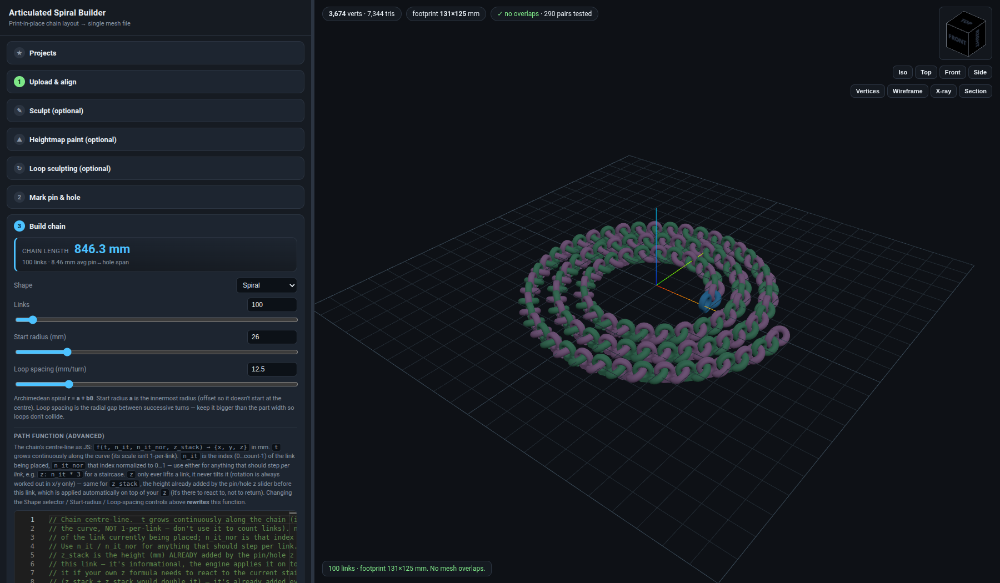
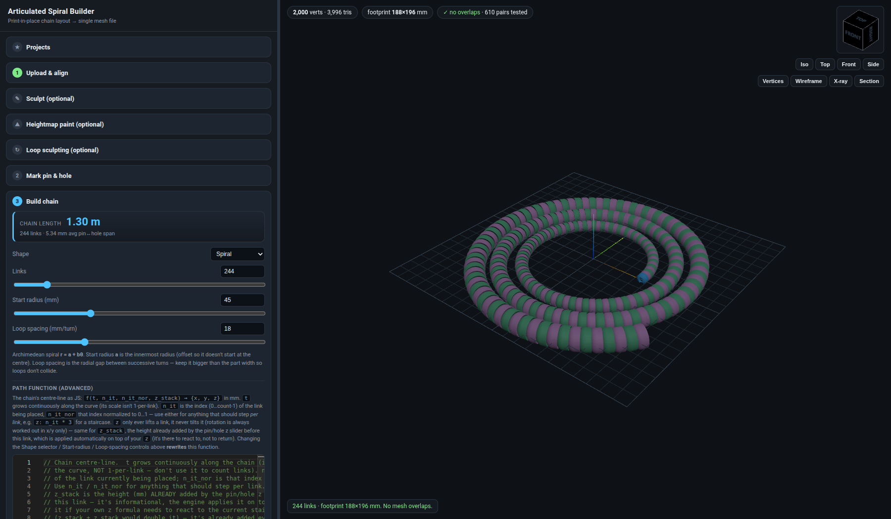
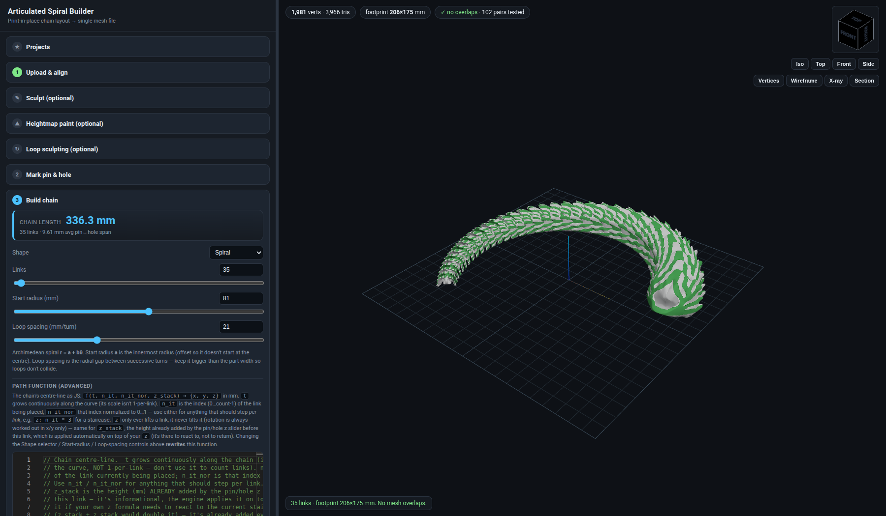
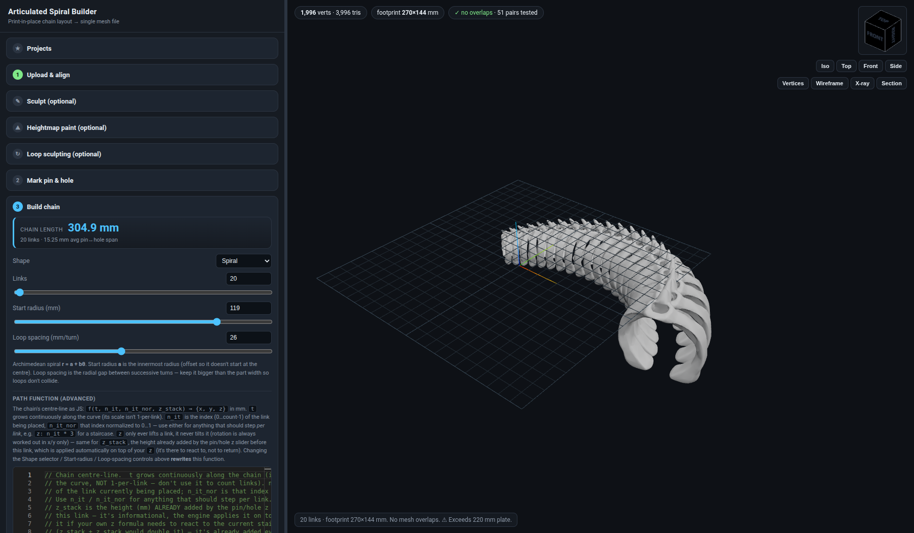
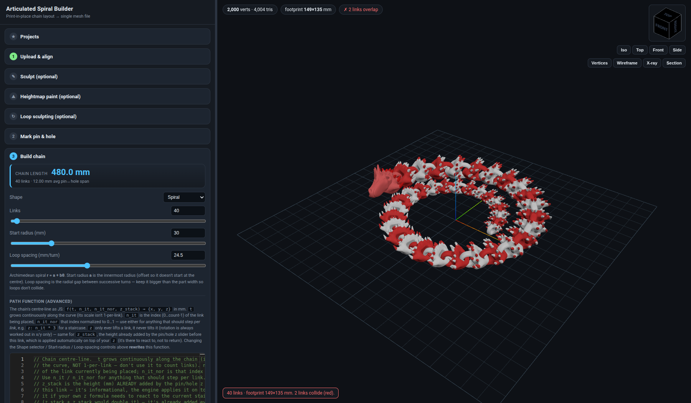
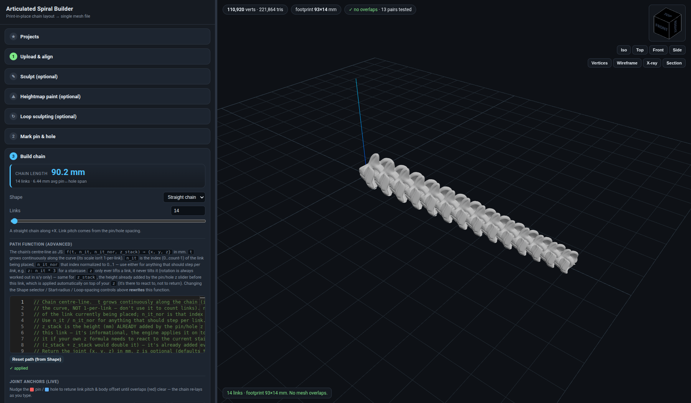
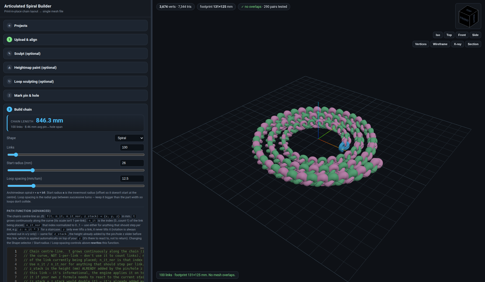

# Articulated Spiral Builder (oo2) — App Summary

> Browser app that turns **one 3D part** into a **print-in-place articulated chain**: you upload a link
> model, mark where its pin and hole are, and the app lays out N copies along a spiral or straight
> path so that every link interlocks with the next **without touching**, then merges all links into
> one STL / GLB / OBJ / PLY file ready for the slicer.
>
> Along the way it offers a small but complete **mesh-editing toolbox**: PCA alignment, lay-flat,
> CSG flatten, mirror-plane detection, decimation, a **symmetric sculpt brush** (draw / carve /
> smooth), **heightmap relief painting**, node-based **progressive deformation**, undo/redo,
> x-ray & section views, BVH collision checking. Those are the parts most relevant for porting
> into another sculpting app — see [PORTING_GUIDE.md](PORTING_GUIDE.md).

Folder contents:

| Path | What it is |
|---|---|
| `README.md` | This overview |
| `PORTING_GUIDE.md` | Feature-by-feature implementation notes for re-creating the functionality elsewhere |
| `screenshots/` + `screenshots/INDEX.md` | 41 screenshots of the running app with loaded example projects |
| `example_projects/` | 7 exported project configs (JSON) + the small link meshes they reference |
| `reference_code/` | Verbatim copies of the reusable modules (`sculpt/`, `heightmap/`, `EditHistory.js`, `ViewCube.js`) and `app_js_excerpts.md` with the key engine routines from `app.js` |

---

## 1. What the app does (user's view)



The UI is a **step wizard in a left panel** plus a **three.js viewport**. Steps are accordion
sections; later steps unlock as earlier ones are completed. Viewport HUD chips show vertex/triangle
count, footprint, and collision status. Corner widgets: a **view cube**, Iso/Top/Front/Side buttons,
and render toggles **Vertices / Wireframe / X-ray / Section**.

| # | Step | What happens |
|---|---|---|
| ★ | **Projects** | Save / load / delete named projects on a tiny Deno server (`data/projects.json` + uploaded meshes in `data/meshes/`). |
| 1 | **Upload & align** | Drop `.stl/.ply/.obj/.glb/.gltf`. Auto-align (PCA), 90° nudges, pick-a-face → lay flat, numeric X/Y/Z rotation. **Flatten bottom** (CSG cut). **Find mirror lines** (symmetry detection). **Simplify** (decimate to a per-link vertex budget with STL size estimate). **Mirror half** (build a full part from a half model). Colour-shade quantisation for vertex-coloured models. |
| ✎ | **Sculpt** (optional) | Brush sculpting on the part: Draw / Carve / Smooth, radius + strength, **mirror every stroke** across the detected or manual plane, undo/redo, mesh repair. |
| ⛰ | **Heightmap paint** (optional) | Load a greyscale image, tone-adjust it (levels, contrast, shadows/highlights, invert), then **paint a mask** on the mesh where the relief should appear. Displacement along normals or an axis; planar / UV / camera mapping. Non-destructive: always recomputed from rest positions. |
| ↻ | **Loop sculpting** (optional) | Place deformation **nodes** on the part (point + direction gizmo + radius + falloff; push / inflate / pinch). Each chain link `i` receives the deformation scaled by a user formula of `n_it_nor = i/(N-1)`, so the shape **evolves along the chain**. Preview slider auditions any link. |
| 2 | **Mark pin & hole** | Click (or type/slide, 0.1 mm steps) the pin and hole positions. Shown as red/blue vertical cylinders. **Mating test**: a translucent ghost of the neighbouring link is placed hole-on-pin and BVH-tested for overlap (green = clears, red = fuses). |
| 3 | **Build chain** | Shape = straight or Archimedean spiral (start radius, loop spacing) **or an arbitrary JS path function** `f(t, n_it, n_it_nor, z_stack) → {x,y,z}` edited in Monaco. Per-link **size formula** (uniform or per-axis) and **colour formula** (tint / palette swap). Live collision check colours overlapping links red. Plate-size check, chain-length readout. |
| 4 | **Export** | **Swap individual links** for a different model (e.g. a head or clasp) and nudge it with a move/rotate gizmo. Merge everything into one mesh and download in the original file's format. Save/load config JSON. |

### Example results (loaded from saved projects)

| | |
|---|---|
|  `ultralongversion` — 244 links, 1.30 m |  `drag2` — dragon segments, 35 links |
|  `shartk2` — pin and hole at different z → chain climbs like a ladder |  `dragon2` — link 39 swapped for a head model; 2 red links flag a collision |
|  `croc` — straight chain, 110 k-vertex part |  `longchain` + a loop-sculpt inflate node: links grow along the chain |

---

## 2. Architecture

```
index.html   Alpine.js UI (x-data="chainApp"), import map, Monaco loader       (591 lines)
app.js       Engine: three.js scene, all steps, chain solver, export, API client (2,913 lines)
styles.css
sculpt/      Brush.js, SculptController.js, MirrorHelper.js, MeshRepair.js, Voxelizer.js (design notes only)
heightmap/   HeightmapEditor.js, HeightmapProjector.js, PaintMask.js, DisplacementController.js
EditHistory.js   generic undo/redo stack (closures per step)
ViewCube.js      corner orientation cube with its own mini renderer
server.ts    Deno: static files + REST  /api/projects (CRUD, JSON file)  /api/meshes (upload/serve)
data/        runtime: projects.json, meshes/*.glb|stl   (35 saved projects, 42 MB of meshes)
```

**No build step.** ES modules loaded from CDNs via an import map:

| Library | Version | Used for |
|---|---|---|
| three | 0.160.0 | rendering, loaders/exporters (STL, PLY, OBJ, GLTF), OrbitControls, TransformControls, BufferGeometryUtils, EdgesGeometry, clipping planes |
| three-mesh-bvh | 0.7.4 | accelerated raycast, `shapecast` vertex gathering for brushes, `intersectsGeometry` collision tests, `closestPointToPoint` for symmetry scoring, `refit()` mid-stroke |
| three-bvh-csg | 0.0.17 | boolean subtraction for "Flatten bottom" |
| meshoptimizer | 0.22.0 | `simplify` / `simplifyWithAttributes` decimation (with colour attributes, `LockBorder`) |
| Alpine.js | 3.x | reactive side panel; engine reads/writes `UI.*` and uses `$watch` |
| Monaco editor | 0.45.0 | the three JS formula editors (path, scale, colour) |

**State model.** One module-level `S` object holds engine state (`baseGeo`, `partMesh`, `poses`,
`symPlanes`, `lsNodes`, `overrides`, …); one Alpine component instance `UI` holds everything
reactive. Watchers on `UI` call engine functions; engine functions write back to `UI` for display.
The part's transform is always **baked into the geometry** (`bakeMatrix`) so the part mesh matrix is
identity — this keeps raycasts, mirror planes, BVH and sculpting all in one coordinate frame.

**Coordinate convention.** Z up, XY is the build plate, millimetres. OrbitControls' wheel-zoom is
replaced by a custom dolly (three r160 bug with `devicePixelRatio < 1`).

**Persistence.** `gatherConfig()` → `{version, pin, hole, partX/Y/Z, params{shape,count,startR,
spacing,plate}, scaleCode, colorCode, pathCode, symPlanes, mirror, lsNodes, meshId, overrides[]}`.
Meshes are uploaded once (`POST /api/meshes`, returns a UUID filename) and referenced by id; the
config can alternatively inline geometry arrays for a standalone JSON download.

---

## 3. Core algorithms (short form; details + code in PORTING_GUIDE.md)

* **Chain layout** (`buildPoses`): local hole→pin vector `V`. For each link, walk the path
  parameter `t` until the XY chord from the previous joint equals `|V_xy|` (bisection, 50 iters),
  rotate about Z so the link's hole→pin direction matches the chord, scale per-link, then translate
  so the hole lands on the previous pin. z from the path or from the pin/hole z-difference only
  *lifts*, never tilts (so stacking stays printable).
* **Collision**: AABB broadphase on a uniform grid → `bvh.intersectsGeometry(otherGeo, relMatrix)`
  per candidate pair. Skipped automatically above 400 links (manual "Re-check").
* **PCA auto-align**: covariance → 3×3 Jacobi eigen-decomposition → right-handed basis → bake.
* **Lay flat**: pick a triangle, rotate its normal to −Z, drop the part to z = 0.
* **Flatten bottom**: CSG subtract a big box whose top face is at the cut height, rebase to z = 0.
* **Mirror-plane detection**: sample ~1400 vertices, for 72 candidate vertical planes through the
  centroid compute RMS distance of reflected points to the surface (BVH closest point); local minima
  under 2 % of bbox diagonal are planes; refine ±1 step.
* **Decimation**: meshoptimizer simplify, binary search on target triangle count until the
  resulting *vertex* count ≤ budget; falls back to grid-cluster decimation offline. STL bytes =
  84 + 50·tris used for the size estimate.
* **Sculpt brush**: BVH `shapecast` gathers vertices within radius; weight `(1−(d/r)²)²`; Draw/Carve
  move along vertex normals with a front-facing filter; Smooth moves toward the neighbour average
  (adjacency list). Mirror = stamp again at the reflected point/normal; seam vertices snapped back
  onto the plane. Normals recomputed live under 40 k verts, else on pointer-up. BVH `refit()` after
  each stamp.
* **Heightmap displacement**: `pos = base + dir · height(uv) · strength · mask`; everything is
  re-derived from stored rest positions so parameters never compound. Mask painted with the same
  brush, Laplacian-blurrable.
* **Loop sculpting**: node list `{pos, dir, radius, falloff, mode, intensity, fn}`; at export each
  link's geometry copy gets `Δ = mode_dir · intensity · fn(n_it, n_it_nor) · falloff(d/r)`.
* **Undo/redo**: `EditHistory` with per-step `undo`/`redo` closures; sculpt steps snapshot the
  position buffer, heightmap steps snapshot the mask. History is cleared when topology changes.

---

## 4. Known gaps / TODOs recorded in the repo

* Voxel remesh is a documented design, not implemented (`sculpt/Voxelizer.js`).
* Hole filling in `MeshRepair` is not implemented (weld + drop degenerate only).
* `todo` file: orthographic view; replace the part while keeping the rest of the project config.
* An older note says loading a project produced "horrible looking geometry" — in the screenshots
  taken today (Nov 2026) loaded projects render correctly.

---

## 5. How these screenshots were produced

Server: `PORT=8005 deno run --allow-net --allow-read --allow-write --allow-env server.ts`.
Screenshots: headless system Chrome driven by Playwright (SwiftShader WebGL), loading each project
through the Alpine component (`loadProject(id)`), switching steps with `toggleStep()`, framing with
`setView()`. Scripts live in the session scratchpad, not in the repo.
