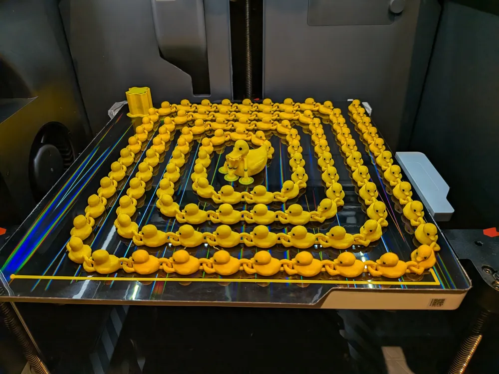

the app should also allow the user to load and place an object that is then fused with the articulation link. 

the object should be movable, resizable and rotatable with a gizmo similar to the gizmo in nomad sculpt. 

the placed object should be fused/merged with the chain link. 

the loaded object is expected to be multicolor and the output chain should also be multi color 

the final chain will then be a chain with funny objects like for example a duck chain

as an example object i will load try to make a chilli chain with this object /home/mintuser/code/oo2/object_chain/8c3f6a42579c5f4eda3dc61407db32fa/d50c5a5fb213970e77d2988224b69710.obj

